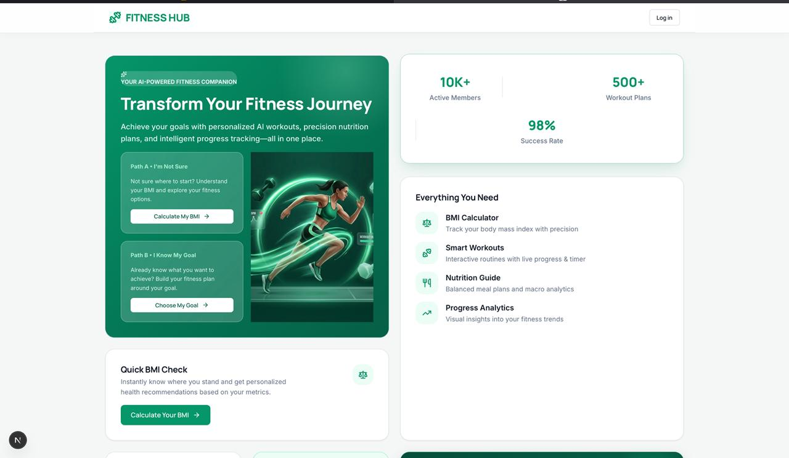
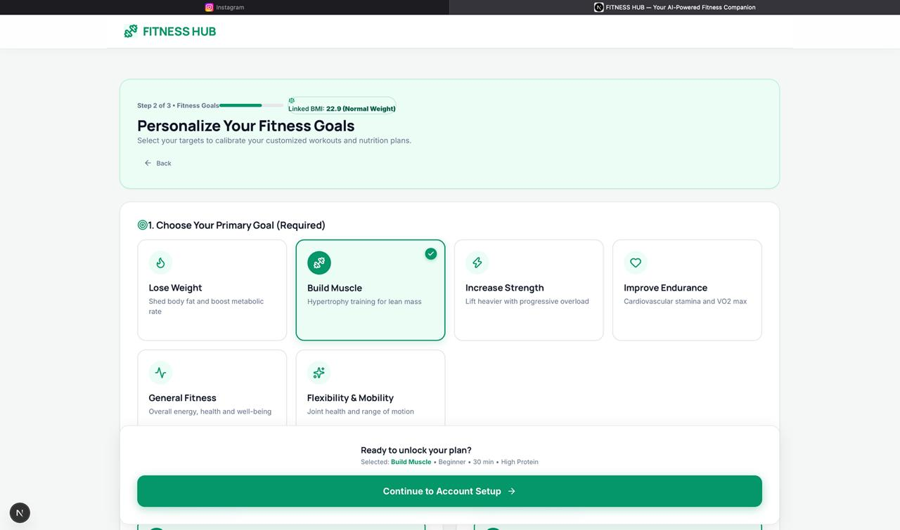
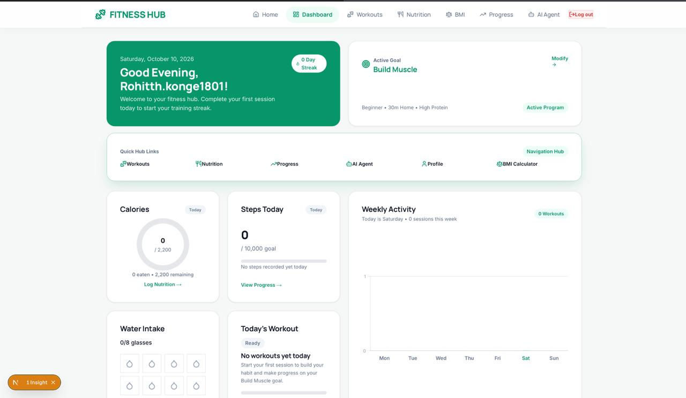
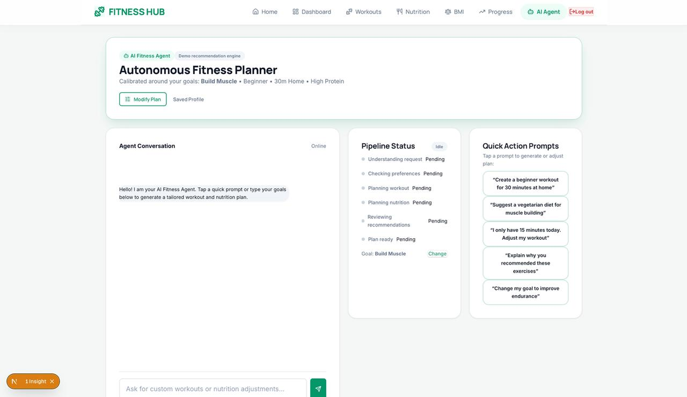

# FITNESS HUB

A personalized AI-powered fitness companion: BMI, goals, workouts, nutrition, progress, and an AI Fitness Agent in one app.


---

## 🎯 Problem

Beginners often struggle to start their fitness journeys due to conflicting online advice, unclear starting points, and the friction of planning routines from scratch. Without structured guidance that connects baseline health metrics to tangible goals, most novices abandon their routines within the first two weeks.

## 💡 Solution

FITNESS HUB removes decision fatigue through a guided, step-by-step onboarding experience tailored to individual readiness. By connecting initial health baselines with personalized goals, smart workouts, nutrition tracking, and an interactive AI Agent, the platform gives users a single, cohesive hub for their fitness goals.

## 🗺️ User Journey

The onboarding experience supports two distinct pathways depending on user clarity:

```text
Path A ("I'm Not Sure"):
Landing ➔ BMI Calculator ➔ BMI Result ➔ Goal Selection ➔ Signup / Login ➔ Dashboard

Path B ("I Know My Goal"):
Landing ➔ Goal Selection ➔ Signup / Login ➔ Dashboard
```

## ✨ Key Features

| Feature | Description |
| :--- | :--- |
| **BMI Calculator** | Dual-unit calculator supporting Metric (`cm`, `kg`) and Imperial (`ft/in`, `lbs`) modes with optional age and gender inputs, delivering instant BMI scores and target weight insights. |
| **Goal Selection** | Guided onboarding wizard to select primary goals (*Lose Weight*, *Build Muscle*, *Keep Fit*, *Improve Endurance*), experience levels, workout locations, session durations, and dietary preferences. |
| **Dashboard** | Centralized Bento Grid hub displaying workout streaks, daily habit rings, weekly activity bar charts, upcoming routines, and quick nutritional summaries. |
| **Smart Workouts** | Structured training routines with interactive exercise checklists, active rest timers, exercise descriptions, and set-by-set tracking. |
| **Nutrition Guide** | Calorie targets and macro distribution (*Protein*, *Carbohydrates*, *Fats*), hydration water tracker, meal recommendations, and daily nutritional tips. |
| **Progress Analytics** | Visual trend monitoring powered by Chart.js, featuring baseline-to-current weight tracking, weekly consistency metrics, and milestone achievement badges. |
| **AI Fitness Agent** | Interactive, six-stage workout and meal plan generator that analyzes athlete preferences, builds calibrated routines, and saves accepted plans directly to the active profile. |

## 🤖 AI Fitness Agent

The AI Fitness Agent features a structured, multi-stage recommendation workflow:

```text
User Request ➔ Analyze Preferences ➔ Workout Plan ➔ Nutrition Plan ➔ Review ➔ Accept / Modify
```

Users can adjust goals, swap exercises, modify calorie targets, and inspect generated weekly routines before committing them to their profile. 

> **Notice**: The current AI Agent is an algorithmic demo recommendation engine running client-side logic. It does not connect to a live large language model (LLM) backend.

## 📸 Screenshots

| Landing Page | Goal Selection |
| :---: | :---: |
|  |  |

| Dashboard | AI Fitness Agent |
| :---: | :---: |
|  |  |

## 🛠️ Tech Stack

- **Framework**: [Next.js 16](https://nextjs.org/) (App Router, Turbopack)
- **UI Library**: [React 19](https://react.dev/)
- **Language**: [TypeScript](https://www.typescriptlang.org/)
- **Data Visualization**: [Chart.js](https://www.chartjs.org/) & [react-chartjs-2](https://react-chartjs-2.js.org/)
- **Icons**: [Lucide React](https://lucide.dev/)
- **Design System**: Vanilla CSS with emerald-green Bento Grid tokens and Manrope headings

## 🚀 Getting Started

1. **Clone the repository**:
   ```bash
   git clone https://github.com/Rohitthkonge/fitness-hub.git
   cd fitness-hub
   ```

2. **Install dependencies**:
   ```bash
   npm install
   ```

3. **Start the local development server**:
   ```bash
   npm run dev
   ```

4. **View in browser**:
   Navigate to [http://localhost:3000](http://localhost:3000).

## 📁 Project Structure

```text
fitness-hub/
├── docs/
│   └── screenshots/          # Application screenshot assets
├── public/                   # Static imagery and public assets
├── src/
│   ├── app/                  # Next.js App Router pages
│   │   ├── page.tsx          # Landing page with dual onboarding paths
│   │   ├── layout.tsx        # Root HTML shell
│   │   ├── bmi/              # Metric / Imperial BMI calculator
│   │   ├── bmi-result/       # Calculated BMI classification & target range
│   │   ├── goals/            # 5-step goal selection wizard
│   │   ├── login/            # Split-screen authentication login
│   │   ├── signup/           # Split-screen account creation
│   │   ├── dashboard/        # Main athlete Bento Grid dashboard
│   │   ├── workouts/         # Interactive workouts & exercise timer
│   │   ├── nutrition/        # Meal planning & macro tracker
│   │   ├── progress/         # Weight history charts & achievement badges
│   │   ├── profile/          # Active athlete profile & saved plans
│   │   └── ai-agent/         # 6-stage AI Fitness Agent generator
│   ├── components/           # Reusable UI components
│   │   ├── AppLayout.tsx     # Route guarding & navigation layout switch
│   │   ├── Navigation.tsx    # Authenticated navigation bar with logout
│   │   ├── SimpleHeader.tsx  # Public header with logo and landing CTA
│   │   ├── Footer.tsx        # Context-aware footer
│   │   └── AnimatedCounter.tsx
│   ├── lib/                  # State management & chart helpers
│   │   ├── auth.tsx          # Simulated session provider & hook
│   │   └── chartjs.ts        # Chart.js element registration
│   └── styles/               # Design system & page styles
│       ├── design-system.css # Bento grid utilities & color tokens
│       └── pages.css         # Page-specific styling
└── README.md
```

## 📝 Prototype Notes

- **Simulated Authentication**: Uses client-side `localStorage` (`fithub_user`) to simulate sessions across routes and test access guards.
- **Demo Data**: Some dashboard statistics, community metrics, and chart baselines are preloaded with labeled demo data for evaluation.
- **Simulated AI Engine**: Plan generation logic is rule-based and simulates an AI assistant workflow client-side.
- **Production Readiness**: This repository is a front-end prototype designed to validate user journeys and interface patterns.

## 🔮 Future Scope

- **Real Authentication & Database**: Implement Supabase or NextAuth with a PostgreSQL backend for secure user accounts.
- **Live LLM Integration**: Connect the AI Agent to real-time AI models for conversational workout and diet adjustments.
- **Wearable & Health Sync**: Integrate Apple Health, Google Health Connect, and wearable fitness trackers for live step and heart rate data.
- **Mobile Application**: Build a cross-platform mobile app using React Native to support on-the-go gym tracking.

## 👥 Team

- Rohitth K
- Mohan Charan Teja B
- Maheswar S
- Sriram S
